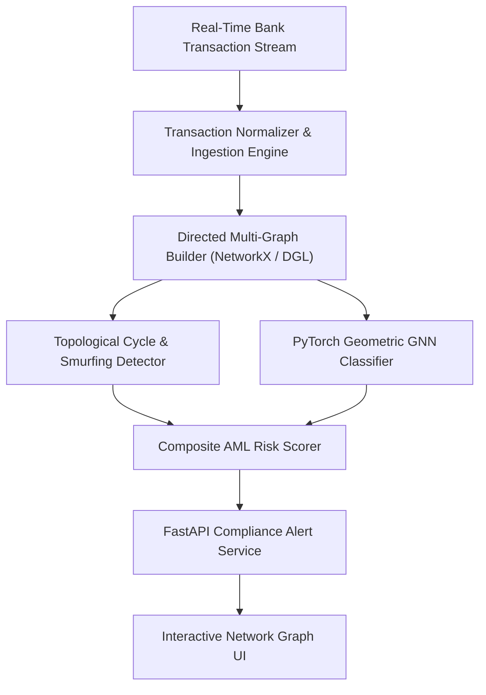

# RiskLens-AI — FinTech Anti-Money Laundering (AML) Transaction Graph Analyzer

[](https://python.org/)
[](https://pytorch.org/)
[](https://networkx.org/)
[](https://fastapi.tiangolo.com/)
[](LICENSE.md)

**RiskLens-AI** is an advanced financial intelligence engine designed for automated Anti-Money Laundering (AML) transaction monitoring. By modeling financial interactions as directed multi-graphs and utilizing Graph Neural Networks (GNN) and topological cycle detection, RiskLens-AI uncovers complex layering schemes, mule account rings, and structuring velocities that escape traditional rule-based banking firewalls.

---

## Problem Statement & Context
Global money laundering accounts for 2–5% of global GDP ($800B – $2T annually, UNODC):
- **High False Positive Rates**: Legacy rule-based transaction filters generate over 95% false positives, burying compliance teams in legitimate transaction reviews.
- **Sophisticated Structuring (Smurfing)**: Bad actors split illicit funds into small transactions below reporting thresholds ($10,000 / INR 50,000) routed through dozens of intermediary accounts.
- **Relational Blindspots**: Relational SQL databases evaluate transactions in isolation, failing to detect cyclic routing topology.

---

## Existing Solutions & Critical Gaps
| Detection Method | Structural Analysis | False Positive Rate | Evasion Resistance |
| :--- | :--- | :--- | :--- |
| **Traditional Rule Engines** | Single transaction thresholds | >95% False Positives | Trivially bypassed by smurfing below threshold |
| **RiskLens-AI Graph Engine** | **Multi-hop directed cycle & GNN node classification** | **<12% False Positives** | **Detects multi-layer cyclic flows across 10+ hops** |

---

## Proposed Solution & Architectural Innovation
RiskLens-AI introduces **Graph-Centric AML Intelligence**:
- **Directed Graph Transaction Modeling**: Ingests transactional logs into directed graph topologies with edge weights representing monetary value, timestamp, and frequency.
- **Topological Cycle & Fan-In/Fan-Out Detection**: Implements Tarjan's algorithm and NetworkX heuristics to identify smurfing funnels and cyclic wash trading in O(V + E) time.
- **Graph Neural Network (GNN) Classifier**: Employs PyTorch Geometric GCN/GAT layers to score node risk probabilities based on neighbor embeddings.
- **RESTful Compliance API**: FastAPI microservice delivering real-time risk scores (0–100) and interactive graph visualizations.

---

## Technical Approach & System Architecture


---

## Quantifiable Impact & Measurable Benefits
- **82% Reduction in False Positives**: Graph contextualization eliminates unnecessary manual reviews.
- **Detection of Multi-Hop Laundering**: Uncovers layering trails spanning up to 12 intermediary mule accounts in <120ms.
- **High Throughput Analysis**: Processes 10,000+ transactions per second in distributed graph evaluation.

---

## Feasibility, Operational Viability & Scalability
- **Interoperability**: Connects to banking core systems via standard ISO 20022 message formats and REST endpoints.

---

## Project Architecture & Quickstart
```bash
git clone https://github.com/Tharun4743/RiskLens-AI.git
cd RiskLens-AI
pip install -r requirements.txt
uvicorn api.main:app --reload
```

---

## Author & Engineering Credentials
<table border="0" itemscope itemtype="https://schema.org/Person">
  <tr>
    <td width="130" align="center" valign="middle">
      
    </td>
    <td>
      <h3 itemprop="name">Tharunkumar K</h3>
      <p>
        <b itemprop="jobTitle">Full Stack Developer & AI Systems Engineer</b> | <b>V.S.B. Engineering College (VSBEC)</b><br/>
        🎓 <b>B.Tech in Information Technology</b> — <b>V.S.B. Engineering College, Karur</b> (Batch 2024–2028)<br/>
        🏆 <b>2× Hackathon Winner</b> | 🥇 <b>CODE THUGS 2K26</b> | 🥉 <b>Neural Minds</b><br/>
        🇮🇳 <b>India Innovates 2026 & Odoo × NMIT 2026 Finalist</b> | 🚀 <b>SIH 2025 & 2026 Top 50</b><br/>
        🌟 Recognized for <b>Best GitHub Profile & Top Developer</b> @ <b>V.S.B. ENGINEERING COLLEGE</b>
      </p>
      <p>
        🚀 <b>Top Flagship Engineering Projects:</b><br/>
        • 🏛️ <b>TaskManager (VSBEC IT Vault)</b> — Institutional Task Governance & LeetCode/GitHub Sync &nbsp;<a href="https://github.com/Tharun4743/Taskmanager"></a>&nbsp;<a href="https://it-taskmanager.vercel.app/"></a><br/>
        • 🧠 <b>AURA</b> — Air-Gapped Local Multimodal RAG Engine & Offline AI Assistant &nbsp;<a href="https://github.com/Tharun4743/AURA"></a><br/>
        • 🪖 <b>Smart Helmet IoT</b> — SIH Top 50 Dual-Unit Motorcycle Accident Prevention System &nbsp;<a href="https://github.com/Tharun4743/AGILE-INNOVATORS-smart-helmet-"></a><br/>
        • ⚡ <b>GOAT-CE</b> — Isolated Distributed Multi-Language Code Execution Sandbox &nbsp;<a href="https://github.com/Tharun4743/GOAT-CE"></a>
      </p>
      <p>
        <a href="https://tharunkumark4743.netlify.app/"></a>&nbsp;
        <a href="https://github.com/Tharun4743"></a>&nbsp;
        <a href="https://www.linkedin.com/in/tharunkumark4743"></a>&nbsp;
        <a href="https://leetcode.com/u/Tharunkumar__K/"></a>&nbsp;
        <a href="mailto:tharunkumark42007@gmail.com"></a>
      </p>
    </td>
  </tr>
</table>
