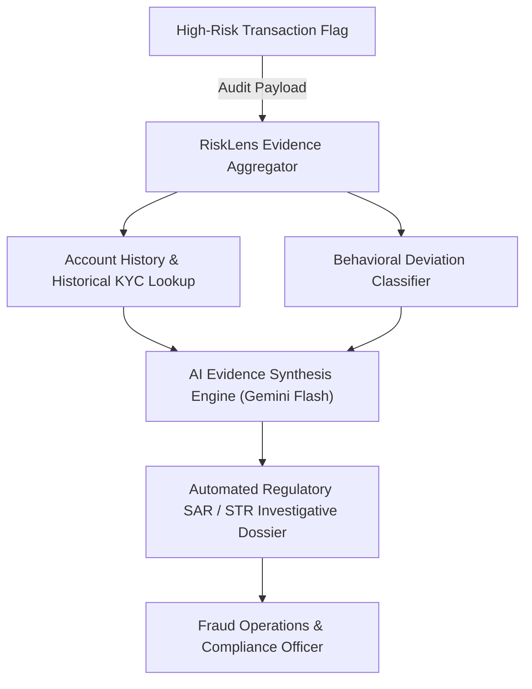

# 🔍 RiskLens AI — Evidence-First Banking Transaction Risk Investigation Assistant
### *AI-Powered Financial Fraud Detection, Anomaly Scoring & Regulatory Audit Dossier Generator for Banking Analysts*

  

  <a href="https://github.com/Tharun4743/RiskLens-AI">📦 <b>Official GitHub Repository</b></a>
  

---

## 1. 📌 Problem Statement & Context
Banking compliance and fraud investigation analysts are inundated with tens of thousands of daily financial transactions. Manually combing through account ledgers to detect money laundering, rapid pass-through structuring, and sudden velocity anomalies is slow, error-prone, and causes massive regulatory backlog.

---

## 2. 🔍 Existing Solutions & Critical Gaps
Traditional rules-based banking filters produce staggering false-positive rates (>90%) and lack explainable narrative reasoning, forcing human analysts to spend hours manually writing Suspicious Activity Reports (SARs).

---

## 3. 💡 Proposed Solution & Architectural Innovation
RiskLens AI is an intelligent financial transaction risk investigation platform. It automatically ingests banking transaction histories, computes multi-dimensional anomaly risk scores (velocity spikes, high-risk merchant categories, circular transfers), and synthesizes evidence-first investigation dossiers with actionable recommendations for compliance officers.

---

## 4. ⚙️ Technical Approach & System Architecture

### 📐 High-Level Architectural Flowchart:

| Investigation Pipeline | Technologies | Operational Outcome |
| :--- | :--- | :--- |
| **Ingestion & ETL** | Python, Pandas, NumPy | Cleans and normalizes raw transaction logs, timestamps, and merchant codes |
| **Anomaly Engine** | Scikit-Learn (Isolation Forest / DBSCAN) | Calculates multidimensional risk scores based on velocity and historical spending |
| **Dossier Generator** | LLM Structured Output Pipeline | Automatically drafts standardized Suspicious Activity Report (SAR) narratives |

---

## 5. 📈 Quantifiable Impact & Measurable Benefits
* ⚡ **80% Faster Case Investigations:** Transforms hours of manual ledger auditing into instant, evidence-backed risk dossiers.
* 🔍 **Evidence-First Explanations:** Every flagged risk is directly linked to specific timestamped transactions and monetary thresholds.
* ⚖️ **Regulatory Compliance:** Generates audit-ready reports ready for financial intelligence units.

---

## 6. 🚀 Feasibility, Operational Viability & Scalability
* 🔬 **Technical Feasibility:** Python-based data pipeline readily integrates with standard banking core data lakes and CSV/Parquet streams.
* 💰 **Economic Viability:** Immense cost savings for commercial banks and fintechs by reducing manual compliance labor and regulatory penalty risks.
* 📈 **Scalability:** Can be containerized with Apache Spark or Ray for distributed processing across millions of daily payment transactions.

---

## 7. 👨‍💻 Author & Intellectual Property License

## 👨‍💻 Engineering Author

<table border="0">
  <tr>
    <td width="120" align="center" valign="top">
      
    </td>
    <td>
      <h3>Tharunkumar K</h3>
      

        <b>Full Stack Developer & AI Systems Engineer</b> 
        🎓 B.Tech in Information Technology — <a href="https://vsbec.com"><b>V.S.B. Engineering College, Karur</b></a> (Batch 2024–2028) 
        🌟 Recognized for holding the <b>Best GitHub Profile & Top Student Developer</b> at V.S.B. Engineering College (VSBEC) 
        🥇 <b>Winner — Code Thugs 2K26</b> • 🚀 <b>Smart India Hackathon (SIH)</b> Top 50 National Finalist
      

      

        <a href="https://tharunkumark4743.netlify.app/">🌐 Portfolio</a> •
        <a href="https://github.com/Tharun4743">🐙 GitHub (@Tharun4743)</a> •
        <a href="https://www.linkedin.com/in/tharunkumark4743">💼 LinkedIn</a> •
        <a href="https://leetcode.com/u/Tharunkumar__K/">🧩 LeetCode</a> •
        <a href="mailto:tharunkumark42007@gmail.com">📧 Email</a>
      

    </td>
  </tr>
</table>

<!-- =========================================================================
   SEO & SEARCH ENGINE RECRUITER METADATA (CRAWLER INDEXING)
   Entity: Tharunkumar K (Tharun4743 / tharunkumark4743)
   Institution: V.S.B. Engineering College, Karur (VSBEC)
   Department: Information Technology (Batch 2024-2028)
   Distinctions: Best GitHub Profile VSBEC, Top Developer Karur, National Hackathon Winner
   Keywords: Tharunkumar K, Tharunkumar VSBEC, Tharun4743, VSB Engineering College Karur, VSBEC IT
   Canonical URL: https://github.com/Tharun4743/RiskLens-AI
========================================================================= -->
